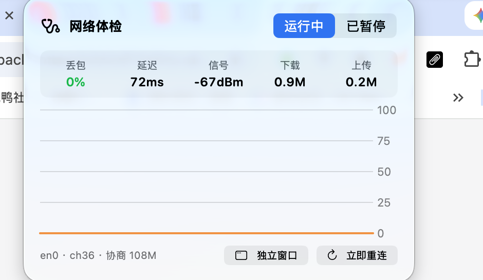

# WiFiDoctor · 网络体检

给**酒店 / 公共 Wi-Fi** 用的 macOS 网络质量监测与自动恢复工具。

<p align="center">
  
</p>

## 为什么会有这个工具

出差住酒店时经常遇到这些：

- 网速白天 1–2 Mbps，晚上 8 点后掉到几百 Kbps
- 凌晨 1–4 点会「假死」：信号正常、信道空闲，但丢包 50%+
- 掉线后不会自动重连，得手动切热点
- 手机热点也不一定管用——晚高峰基站一样堵

反复实测后发现规律，所以做了这套东西。**它不是通用网���检测器，是专门对付「被超售的酒店 Wi-Fi」。**

### 关键发现（来自实测数据）

| 现象 | 真实原因 |
|---|---|
| 晚上变慢 | 共享空口拥塞，`ccaOther` 占比升高 |
| 凌晨「假死」 | **AP 不回 ACK**：信号 -65 dBm 正常、信道占用仅 4%，但重传 20–32%、速率跌到 6.5 Mbps |
| 重连就恢复 | 换到另一个 AP 后立刻回到 270–300 Mbps |
| 手机热点也卡 | 晚高峰基站同样拥塞（实测 41 KB/s） |

**核心对策：卡了就重启 Wi-Fi，强制换 AP。**

## 功能

### App（图形界面）

- 菜单栏常驻，实时显示丢包百分比 + 趋势图标
- 悬浮面板：丢包曲线（橙=公网，蓝=网关）、信号、速率、实时上下行
- 持续劣化时发通知：「网络很差，先去做别的」
- 恢复后发通知

### 脚本（后台守护）

| 脚本 | 作用 |
|---|---|
| `scripts/wifi-watch.sh` | 每 5–15 秒采样，写日志，掉线时抓现场 |
| `scripts/wifi-guard.sh` | 常驻后台，两种触发自动恢复：<br>· 连续 3 次**完全不通** → 重启 Wi-Fi<br>· 连续 3 次**丢包 ≥50%** → 重启 Wi-Fi（换 AP）<br>触发后 15 分钟冷却，避免反复折腾 AP |

## 安装

### App

```bash
git clone https://github.com/bjmayor/WiFiDoctor.git
cd WiFiDoctor
./build-app.sh
cp build/WiFiDoctor.app ~/Applications/
open ~/Applications/WiFiDoctor.app
```

需要 macOS 14+、Xcode 16+。

### 后台守护（推荐）

把脚本放到非受保护目录（`~/Documents` 会被 launchd 拒绝读取），然后注册为 LaunchAgent：

```bash
mkdir -p ~/Library/Application\ Support/wifi-monitor
cp scripts/wifi-{watch,guard}.sh ~/Library/Application\ Support/wifi-monitor/
chmod +x ~/Library/Application\ Support/wifi-monitor/*.sh
```

生成 plist（`__LABEL__` 和路径按实际情况替换）：

```bash
for job in watch guard; do
cat > ~/Library/LaunchAgents/com.maynard.wifi-$job.plist <<EOF
<?xml version="1.0" encoding="UTF-8"?>
<!DOCTYPE plist PUBLIC "-//Apple//DTD PLIST 1.0//EN" "http://www.apple.com/DTDs/PropertyList-1.0.dtd">
<plist version="1.0">
<dict>
  <key>Label</key><string>com.maynard.wifi-$job</string>
  <key>ProgramArguments</key>
  <array>
    <string>/bin/bash</string>
    <string>__PATH__/wifi-$job.sh</string>
  </array>
  <key>RunAtLoad</key><true/>
  <key>KeepAlive</key><true/>
</dict>
</plist>
EOF
launchctl bootstrap gui/$(id -u) ~/Library/LaunchAgents/com.maynard.wifi-$job.plist
done
```

> **注意**：脚本必须放在 `~/Library/...` 而不是 `~/Documents/...`，
> 否则 launchd 会报 `Operation not permitted`（macOS TCC 保护）。

## 手动查看日志

```bash
tail -f ~/wifi-watch.log                      # 实时采样
tail -f ~/wifi-guard.log                      # 自动恢复事件
grep "link=DOWN" ~/wifi-watch.log             # 链路断过
grep -E "net=(50|75|100)\.0%" ~/wifi-watch.log  # 严重丢包
```

### 分时报告

想知道「这家酒店几点抢带宽」，用内置脚本：

```bash
python3 wifi-report.py --bin 30 --date 2026-10-20
```

输出类似：

```
时段    平均RTT   丢包    平均速率   评价
21:00   87ms     16.6%     81M      差（晚高峰）
22:00   87ms      1.2%    213M      好
01:00   73ms     54.0%     92M      差（假死）
```

## 调参

```bash
# guard：提高/降低触发灵敏度
WIFI_GUARD_LOSS=40          # 丢包阈值（%）
WIFI_GUARD_LOSS_CYCLES=3    # 连续几次才动手
WIFI_GUARD_COOLDOWN=900     # 冷却（秒）
```

## 技术说明

几个踩过的坑，记录在此避免重蹈覆辙：

- **网卡字节计数不能直接读 `getifaddrs` 的 `ifa_data`**：那是内核私有结构，偏移随架构变化，实测把 5 GB 读成 1.7e14。最终改用 `netstat -ib` 解析
- **RSSI 需要定位权限**（macOS 14+）：拿不到时降级为 `nil` 而不是崩溃
- **ping 要用 1 秒间隔**：0.3 秒会被路由器 ICMP 限速，测出 60% 假丢包
- **App Store 沙箱禁止执行 `networksetup`**：`NetworkRecovery` 协议已抽象好，上架时替换实现即可，UI 无需改动

## License

MIT